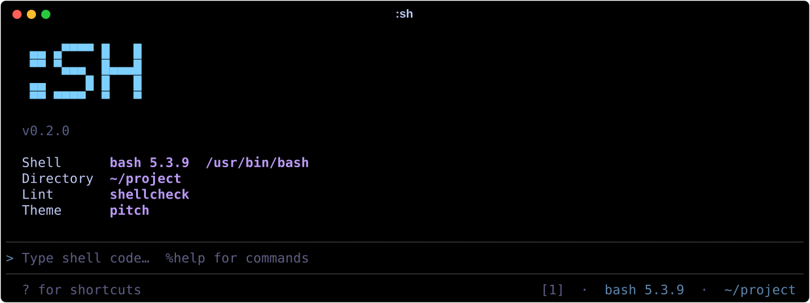
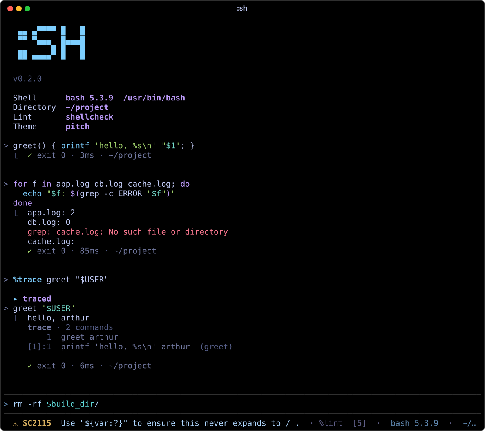

<div align="center">



# ✓ :sh

**A playground for writing and testing shell scripts.**
Run shell code cell by cell in a persistent session, step through scripts, trace them, lint them, compare shells, sandbox them and assert on the results.

[](https://github.com/arthurdaquinosilva/sh-term/tags)
[](https://github.com/arthurdaquinosilva/sh-term/actions/workflows/tests.yml)
[](https://github.com/arthurdaquinosilva/sh-term/blob/main/pyproject.toml)
[](https://github.com/arthurdaquinosilva/sh-term/blob/main/LICENSE)

</div>

## See it in action

<p align="center">

</p>

The name: **sh** + **tick** (✓, a passing check) — and a *:sh* is a routine you rehearse until it works.

## Why :sh

- **Readable runs.** Every cell is a block: your code, its output under a `⎿` (stderr in red), and a status line with the exit status, time and directory. Variables, functions, `cd` and `set` options carry over between cells.
- **Know what a script does.** Open a script and step through it command by command (`%open`, `%next`, `%step`), or `%trace` it to see every command that ran — with variables expanded — apart from the output.
- **Catch mistakes while typing.** shellcheck lints the input as you type and puts the most important finding in the footer under the prompt. Typing `tar -x` shows what each flag means.
- **Try things without fear.** `%sandbox on` runs cells in a throwaway directory and lists the files each cell created, changed or deleted.
- **Turn experiments into tests.** `%expect exit 0`, `%expect stdout contains "done"`, `%test` to re-run everything in a fresh session, `%save-test` to get a file that `:sh test` checks in CI.
- **Tight loops.** `%watch build.sh` re-runs a script on every save; `%break 42` stops `%run` at a line so you can look around.
- **Portable scripts.** `%compare bash dash zsh` runs the same code in each shell side by side; on macOS, `%compare /bin/bash bash` shows what bash 3.2 does differently.

## Install

```sh
curl -fsSL https://raw.githubusercontent.com/arthurdaquinosilva/sh-term/main/install.sh | sh
```

The script downloads :sh from GitHub into its own virtual environment (`~/.local/share/sh-term/venv`) and links the `:sh` command into `~/.local/bin`, telling you if that isn't on your `PATH`. Run it again to upgrade to the latest code on `main`; add `-s -- 0.2.0` after `sh` for a specific release, or `-s -- --uninstall` to remove it (your config and history stay). [Read it first](https://github.com/arthurdaquinosilva/sh-term/blob/main/install.sh) if you like — it's short.

:sh isn't on PyPI; GitHub is the only place it's published. Then run `:sh`. Requires Python 3.10+ on macOS or Linux, and bash. [shellcheck](https://www.shellcheck.net) is optional but recommended (`brew install shellcheck`, `apt install shellcheck`); dash and zsh are used when installed.

## Quick tour

```sh
> for f in *.log; do grep -c ERROR "$f"; done    # a cell: output, exit status, time, directory
> %open deploy.sh staging    # load a script ($1=staging) and list its commands
> %next                      # run the next one · %step: edit it first · %run: the rest
> %trace --next              # run the next command with every executed step listed
> %sandbox on --copy         # work in a temporary copy of this directory
> ./build.sh
> %expect exit 0             # check the last cell and record the check
> %expect file exists dist/app.tar.gz
> %test                      # re-run all cells in a fresh session, check expectations
> %save-test build.test.sh    # later, in CI: :sh test build.test.sh
> %watch build.sh            # run it again on every save · q stops
> %compare bash dash         # the previous cell in both shells, side by side
> %save build-steps.sh       # the cells that worked, as a script
> %help                      # every key and command
```

| | |
| --- | --- |
| **Enter** | run the cell (adds a newline while the code is unfinished — decided by the shell's own parser) |
| **Shift+Enter** · Alt+Enter · Ctrl+J | insert a newline |
| **Tab** | complete commands, files, `$variables` and `%commands` |
| **→** · **↑ ↓** · Ctrl+R | accept the grey suggestion · history · search history |
| **Ctrl+O** | edit the cell in `$EDITOR` |
| **Ctrl+C** | clear the input (on an empty prompt, twice to exit) · interrupt a running cell (again: kill the session) |
| **Ctrl+D** | exit · end a running cell's stdin |

**vi mode**: `:sh --vi`, or `%vi --save` to keep it. Esc for normal mode, Enter runs from normal mode, `j`/`k` history, `/` search, `v` opens `$EDITOR`.

Shift+Enter needs a terminal that reports modified keys (iTerm2, WezTerm, Ghostty, kitty, xterm; inside tmux set `extended-keys on`). Alt+Enter and Ctrl+J work everywhere.

## Documentation

| Guide | What's inside |
| --- | --- |
| [Features](https://github.com/arthurdaquinosilva/sh-term/blob/main/docs/features.md) | Cells and the session, typing, scripts, tracing, linting, the sandbox, expectations and tests, portability |
| [Command reference](https://github.com/arthurdaquinosilva/sh-term/blob/main/docs/commands.md) | Every `%command` with its options (generated from the code) |
| [Configuration](https://github.com/arthurdaquinosilva/sh-term/blob/main/docs/configuration.md) | `config.toml`, themes, profiles, command-line options, test files |
| [How it works](https://github.com/arthurdaquinosilva/sh-term/blob/main/docs/how-it-works.md) | The session engine: how cells run, finish, read input and get interrupted |
| [Releasing](https://github.com/arthurdaquinosilva/sh-term/blob/main/docs/releasing.md) | How versions are tagged and released on GitHub |

## Command line

```sh
:sh                          # interactive, in bash
:sh --shell dash             # or sh, zsh, a path like /bin/bash
:sh deploy.sh staging        # open a script to step through
:sh -c 'echo hi; false'      # run code as a cell, print the block, exit with its status
:sh test *.test.sh            # run saved tests; exit status 1 if any check fails (--lint: shellcheck too)
:sh --vi --profile work
```

## Development

```sh
git clone https://github.com/arthurdaquinosilva/sh-term.git && cd sh-term
python -m venv .venv && .venv/bin/pip install -e '.[dev]'
.venv/bin/python -m pytest                     # engine, commands, and the UI in a pseudo-terminal
.venv/bin/python scripts/gen_command_docs.py   # regenerate docs/commands.md
.venv/bin/python scripts/screenshot.py         # re-record docs/assets/*.svg from a real session
```

:sh is built on [prompt_toolkit](https://github.com/prompt-toolkit/python-prompt-toolkit) (input and layout), [Rich](https://github.com/Textualize/rich) (output) and [Pygments](https://pygments.org/) (highlighting). It's the sibling of [:py](https://github.com/arthurdaquinosilva/py-term), an interactive Python shell.

## Limits

- **Not a login shell.** :sh is for writing and testing scripts, not for replacing zsh or bash day to day. There's no job control (`fg`, `bg`, Ctrl+Z).
- **No full-screen programs in cells.** vim, htop, less or an ssh session need a real terminal; run them outside :sh. `%tty on` helps programs that only check whether they're on a terminal (colors, `[ -t 1 ]`), at the cost of merging stderr into stdout.
- **Cells run non-interactively**, like scripts: `read -p` prompts aren't printed unless `%tty on`, no `.bashrc` or `.zshrc` is read — set `aliases = "auto"` in the [config](https://github.com/arthurdaquinosilva/sh-term/blob/main/docs/configuration.md#your-aliases) to bring your aliases in.
- **`exit`, `exec` and a failing command under `set -e` end the session.** :sh says so and starts a new one in the same directory, but variables and functions are gone.
- **The sandbox is a working directory**, not a security boundary: absolute paths, `cd ..` and `$HOME` reach the real filesystem (the footer warns when a cell leaves it).
- **Linting** needs shellcheck, which doesn't support zsh.

## License

[MIT](https://github.com/arthurdaquinosilva/sh-term/blob/main/LICENSE) © Arthur D'Aquino
